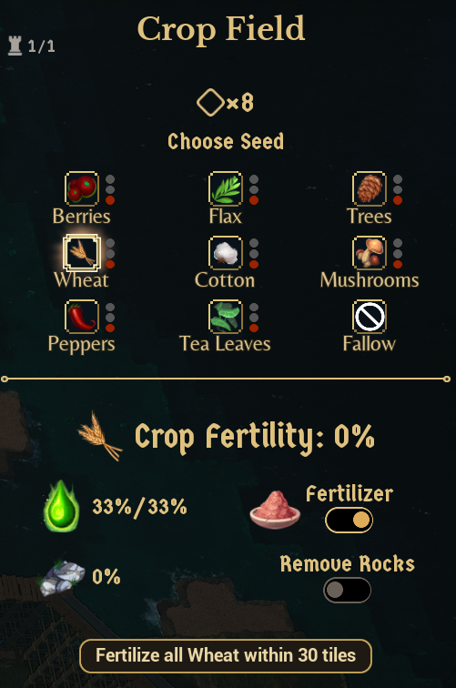

# Fertilizer

A quality-of-life mod for [Whiskerwood](https://store.steampowered.com/app/2489330/Whiskerwood/).

Switching Fertilizer on means opening every crop field one by one. This mod adds a button to the crop field window: **Fertilize all *Wheat* within 30 tiles**. One click turns Fertilizer on for every nearby field growing the same crop as the field you opened.

## Features

- **A button in the crop field window**, under the Fertilizer / Remove Rocks switches. Its label names the field's crop and the range, and it follows the seed you pick while the window is open.
- **Same crop only**: fields growing something else are left alone. On a fallow field the button is greyed out.
- **Only switches Fertilizer on**: it never turns it off, and fields that already have it on are skipped.
- **Setting**: *Fertilizer - range (tiles)* in the Mods menu: 5, 10, 15, 20, 30, 40, 50, 75 or 100 tiles (default **30**).
- **Uses the game's own switch**: the same command the window's Fertilizer toggle sends, so nothing is patched.
- **Works while paused**, and does nothing in the background: the mod only reacts to your clicks.
- After pressing, the button says how many fields it switched on.

## Installing

- **Manually:** put `Fertilizer.pak` and `Fertilizer.uplugin` in
  `%localappdata%\Whiskerwood\Saved\mods\Fertilizer\` (create the folder; file names must stay `Fertilizer.*`).
- Choose the range under **Settings → Mods**. Then open a crop field and press the button.

## Repository layout

| Path | What |
|---|---|
| `Mod/Fertilizer/` | The mod's source assets (`.uasset`) and `Fertilizer.uplugin`. This is the whole mod. |
| `docs/graphs/` | Blueprint graphs as copy-paste text (T3D). Reference only: the `.uasset` files are the source of truth. |
| `tools/` | `t3d.py` + `fertilizer_build.py`: Python generator that writes the graphs in `docs/graphs/` from the modkit's reflection dump. |
| `docs/screenshot.png` | Screenshot, also used as the Workshop preview image. |
| `workshop/` | SteamCMD item file (`Fertilizer.vdf`) and [upload steps](workshop/HOW_TO_UPLOAD.md). |
| `sync-from-modkit.bat` | Copies the mod's assets from the modkit into this repo and stages the built `.pak` + uplugin into `workshop/content/`. |
| `sync-to-steam.bat` | Uploads `workshop/content/` to the Workshop with SteamCMD. |

## Building from source

1. Set up the official [Whiskerwood modkit](https://github.com/Whiskerwood-Modding/Whiskerwood-Project) (custom UE 5.8 build, branch `5.8`, see its README).
2. Copy `Mod/Fertilizer/` from this repo to `Content/Mods/Fertilizer/` in the modkit project.
3. Open the project, right-click the `Fertilizer` folder → **Cook & Install** (Mod Tools). The mod uses pak chunk 24 (`PAL_Fertilizer`).
4. After editing in the editor, run `sync-from-modkit.bat` to copy the changed assets back into `Mod/Fertilizer/`, then commit.
   The script assumes the modkit is at `E:\modding\Whiskerwood-Project`; override with `set MODKIT=D:\other\path` first.

### Regenerating a graph

`python tools/fertilizer_build.py` writes fresh paste text into `tools/out/`. It needs the modkit's `Content/DynamicClasses/Whiskerwood-*.jmap.gz`; set `JMAP=...` if it isn't next to this repo. In the asset's graph: Ctrl+A, Delete, Ctrl+V, then compile. Create the assets in this order, with the variables before pasting:

| Asset | Parent class | Variables / designer |
|---|---|---|
| `BP_Startup` | Actor | none |
| `WBP_FieldHelper` | **UI_FarmFieldDetails** | `State` (Farm Field UI State) |
| `WBP_FertButton` | UserWidget | Designer only: root **Button `Btn`** → **TextBlock `Label`**, both *Is Variable*. Styling is free (the release uses a rounded dark-brown box with a gold outline and gold text). |
| `BP_MapLoad` | Actor | `Debug` (Boolean), `Helper` (WBP_FieldHelper ref), `FertButton` (WBP_FertButton ref), `Waiter` (WBP_ClickWaiter ref), `Win`, `Injected` (User Widget ref), `Target` (Panel Widget ref), `Sel` (Actor ref), `SelRoot` (Vector), `SelSeeds` (Name), `Range`, `Changed` (Integer) |
| `WBP_ClickWaiter` | UserWidget | Designer: empty, or the root set to *Not Hit-Testable*. `Owner` (**Fertilizer's** BP_MapLoad ref: other mods have a BP_MapLoad too), `Waited` (Float) |

Steps the generator can't reproduce:

- `WBP_ClickWaiter`: the **On Click Check** call pastes with a broken Target type. Delete it, drag from the `Owner` variable to create it again, and wire it after *Remove from Parent*.
- If a red event wire (OnLoaded, OnFertClick, OnWindowButton → its *Bind Event* node) pastes unconnected, drag it again.

## How it works

| Asset | Role |
|---|---|
| `BP_Startup` | Runs once at the main menu and registers the mod option `Fertilizer_Range`. |
| `BP_MapLoad` | Runs when a save loads. Puts the button into crop field windows and does the fertilizing. |
| `WBP_FieldHelper` | An invisible copy of the crop field window, used to read and switch any field. |
| `WBP_FertButton` | The button. |
| `WBP_ClickWaiter` | A tiny invisible widget that waits ~0.1 s after a click, then lets `BP_MapLoad` look for the window. |
| `PAL_Fertilizer` | Primary Asset Label that puts the mod into its own pak chunk. |

- Farm fields live inside the game's terrain data, which Blueprints can't reach. The crop field window (`UI_FarmFieldDetails`) can: its private `ComputeState()` returns the field's crop and Fertilizer state, and its private `SetFertilizerActive()` sends the same command as the toggle. `WBP_FieldHelper` is a child class of that window, so it may call both. `BP_MapLoad` points the helper's `Context` at any field tile with `SetObjectPropertyByName` (the property isn't Blueprint-writable).
- Every field tile is a `FarmPlot_C` actor that reports its whole field. Distance is measured in tiles between the tiles' grid positions (`liveFootprint.rootPosition`, X and Y).
- **When the mod runs:**
  - **Left click in the world** (also while paused) or **a click on a button inside the crop field window**: about 0.1 s later the mod looks for an open crop field window. The game creates a new window for every field opened; the mod adds its button to the window's content list and listens to the window's own buttons (seed choices), so the label can follow your seed choice. The waiting uses a widget's tick, because game timers stop while the game is paused.
  - **Button press:** the mod lists the field tiles once, skips the ones farther than the range (cheap grid math), and reads only the nearby ones. The first tile of each matching field with Fertilizer off gets switched on; the field's other tiles then already read *on*, so each field is switched once.
- The button's crop name comes from the game's own text (`resource.<crop>`), so it matches the seed names in the window.

## Debug logging

The mod is silent by default. To see what it does, create `%localappdata%\Whiskerwood\Saved\mods\Fertilizer\debug.txt` with any text in it (an empty file counts as off). Then it writes `Fertilizer ready` on save load, a line when it adds its button to a window, and one line per field it switches on, to `%localappdata%\Whiskerwood\Saved\Logs\modlog.txt`. Workshop copies never contain `debug.txt`.

## Known limitations

- "Nearby" is measured flat (X/Y), ignoring height differences between terraces.
- If the label ever shows an old crop, close and reopen the window; pressing the button always uses the field's current crop.
- The button doesn't switch Fertilizer off again; use the game's toggle on each field for that.

## Credits

Created using the Whiskerwood modkit: https://github.com/Whiskerwood-Modding/Whiskerwood-Project
